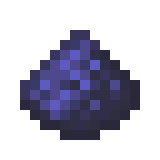
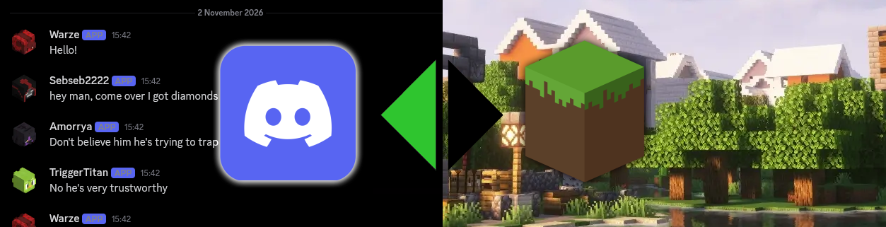

<p align="center">
  
</p>

<h1 align="center">Blurpstone</h1>

<p align="center">
  A Minecraft <strong>Fabric</strong> server mod that bridges in‑game chat with a Discord channel using a built‑in bot for reading and webhooks for posting, so every Minecraft message appears with the player's name and head as the avatar.
</p>

<p align="center">
  <a href="https://blurpstone.warze.org"></a>
  <a href="https://github.com/WarzeDev/blurpstone/releases"></a>
  <a href="https://github.com/WarzeDev/blurpstone/issues"></a>
</p>

---



## What it does

Blurpstone runs a Discord bot **inside** your Minecraft server process. It connects in both directions:

- **Minecraft → Discord**: every player chat message is posted to your configured channel through a Discord **webhook**, so the message appears with the player's username and their skin head as the avatar.
- **Discord → Minecraft**: messages sent by real users in the bridged channel are broadcast to everyone online, prefixed with `[Discord]` and the Discord username.

The bot creates and manages its own webhook the first time it connects, so you don't need to generate one manually.

## Requirements

| Component | Version |
|---|---|
| Minecraft | **26.3** |
| Fabric Loader | **0.19.5** or newer |
| Fabric API | **0.165.0+26.3** or newer |
| Java | **25** (required by Minecraft 26.x) |

The mod is **server‑side only** — clients can connect with a vanilla client.

## Installation

1. Install **Fabric Loader** (≥ 0.19.5) for Minecraft 26.3 on your server.
2. Drop **Fabric API** into your server's `mods/` folder.
3. Download the latest `blurpstone-<version>.jar` from the [**Releases** tab](https://github.com/WarzeDev/blurpstone/releases) and place it in `mods/`.
4. Start the server once. A default config file is generated at `config/blurpstone.json`.
5. Fill in your bot token, guild ID, channel ID, and Discord user ID (see [Configuration](#configuration)).
6. Restart the server. The bot connects, creates the `Blurpstone` webhook in the target channel, and the bridge is live.

### Discord bot setup

1. Create an application at the [Discord Developer Portal](https://discord.com/developers/applications).
2. Under **Bot**, copy the token — this goes into `botToken`.
3. Enable the **Message Content Intent** (required to read chat).
4. Invite the bot to your server with **Read Messages**, **Send Messages**, and **Manage Webhooks** permissions.
5. Enable **Developer Mode** in your Discord client so you can right‑click servers and channels to copy their IDs.

## Configuration

The config file lives at `config/blurpstone.json` inside your server directory and is created automatically on first launch.

```json
{
  "botToken": "YOUR_BOT_TOKEN",
  "guildId": "YOUR_SERVER_ID",
  "channelId": "YOUR_CHANNEL_ID",
  "discordOwnerUserId": "YOUR_DISCORD_USER_ID"
}
```